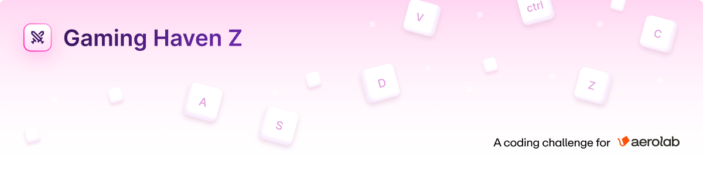

# Gaming Haven Z — Video Game Collection

A responsive web app to discover video games and build your own collection, powered by the IGDB API. Built as my solution to the **Aerolab Frontend Developer Challenge**, following the Figma design pixel by pixel.

**🚀 [Live demo](https://aerolab-challenge-beta-ten.vercel.app/)** · **🎨 [Figma design](https://www.figma.com/design/3O7BxHFnSSawJeny3lXWkE/Aerolab-Frontend-Developer-Coding-Challenge---Public?node-id=16996-5165&t=uLiMR18T28Jegm4s-4)**




## The challenge

Build a video game discovery app on top of the [IGDB API](https://api-docs.igdb.com/): search games, open a detail page for each one, and save them to a personal collection that can be sorted. It had to follow the Figma design mobile-first, handle empty states, and use Next.js (App Router), TypeScript and Tailwind CSS. SEO, animations and error handling counted as extras.

## 🧑‍💻 User stories

- As a player, I want to **search games by part of their name** (`zeld` finds _Zelda_), so I don't have to type the full title.
- As a player, I want to **see popular games when I open the empty search**, so I have somewhere to start.
- As a keyboard user, I want to **move through the results with the arrow keys, open one with Enter and clear the search with Escape**, so I never need the mouse.
- As a player, I want to **open a game's page** with its cover, rating, release date, genres, platforms, developer, summary, screenshots and similar games, so I can decide if it's for me.
- As a player, I want to **add or remove a game from my collection in one click** and get a confirmation, so I know it worked.
- As a returning player, I want **my collection to still be there** when I come back.
- As a player, I want to **sort my collection** by last added, newest or oldest release.
- As a new player with nothing saved yet, I want an **empty state** that tells me what to do.
- As someone sharing a link, I want **a game page to show its title, description and cover** when I paste it in a chat or social network.

## The key decisions

### Design & interaction

**The Figma file became the design system.** I moved the design's colors, type scale and gradients into Tailwind 4 theme tokens (`--color-violet-600`, `text-h1-desktop`, `bg-gradient-linear`), and components are built on those tokens. Every screen stays faithful to the design, and a change in Figma maps to one line of CSS.

**A search that feels instant and never jumps.** Results appear as you type, a loading state holds the dropdown's place while a query is in flight, and picking a result closes the dropdown before navigating, so nothing shifts on screen. When the input is empty, it suggests popular games instead of showing a blank box.

**Fully usable from the keyboard and by screen readers.** The search follows the ARIA combobox pattern (`role="combobox"`, `listbox`, `aria-activedescendant`): arrow keys move through the results, Enter opens one, and Escape works in two steps, first clearing the query and then leaving the input.

**Motion with a purpose.** Animations tell the user where they are: the logo and background keys rise in on first load, the header swaps the logo for a back button when you open a game, and the background moves on detail pages. Every action on the collection gets a toast, so a click is never silent.

**No flash of the wrong state.** The collection is read from the browser after the page loads, so for an instant the app doesn't know what you saved. Instead of flashing "Nothing collected yet" to a returning player, it shows a loader until the saved games are ready.

### Engineering

**Keep the IGDB credentials on the server.** The browser never talks to IGDB. Search and popular games go through two Next.js route handlers, and game pages are server components. The app asks Twitch for the access token itself, caches it, renews it before it expires and retries once if IGDB rejects it. When several requests need a token at the same time, they share one request to Twitch.

**Search the way people type.** IGDB's `search` only matches whole words, so `zeld` returns nothing. I build the query myself instead: each typed word must appear somewhere in the name, ignoring case. The input waits 300 ms after the last keystroke, and a new query cancels the previous request, so a slow answer for an old query can't replace newer results. User input is escaped before it goes into the IGDB query.

**The collection lives in the browser.** The challenge needs no accounts, so a backend would add cost and nothing for the user. A Zustand store saves the collection to `localStorage`, keeping only what a card needs (slug, name, cover, release date and when it was saved). The stored data has a version number, and a migration converts collections saved by the first version, so returning users keep their games.

**Server-rendered game pages for SEO.** Each game page (`/game/[slug]`) is rendered on the server with its own title, description and OpenGraph/Twitter cover, and the site ships a sitemap and `robots.txt`. React's `cache()` lets the metadata and the page share one IGDB request. A game that doesn't exist shows the 404 page, while an IGDB outage shows an error screen, so users can tell the two apart.

## ✨ Features

**Interface**

- Pixel-perfect, mobile-first layout from the Figma design, with tablet and desktop enhancements
- Search dropdown with loading, empty and error states, and popular games while the input is empty
- Screenshot gallery (Swiper) and up to six similar games on each detail page
- Page-load animations, header transitions between pages, animated background keys and gradients
- Toast notifications when a game is added to or removed from the collection

**Data & performance**

- IGDB responses cached for an hour on the server, and API responses served with `stale-while-revalidate`
- In-memory cache of the last 20 game pages looked up
- Images through `next/image`, with placeholders when a game has no cover
- Environment variables validated at startup with `@t3-oss/env-nextjs` and Zod

**SEO & quality**

- Per-game metadata, OpenGraph and Twitter cards, sitemap, `robots.txt`, favicons and web app manifest
- Custom 404 and error pages
- ESLint, Prettier, and Conventional Commits enforced by commitlint and Husky

## 🧱 Architecture

```
src/
├── app/
│   ├── api/games/       # Route handlers: search and popular games (server only)
│   ├── game/[slug]/     # Server-rendered game page + client interactions
│   ├── store/           # Zustand store with localStorage persistence
│   ├── sitemap.ts, robots.ts, error.tsx, not-found.tsx
│   └── layout.tsx       # Root layout, fonts and site metadata
├── components/
│   ├── common/          # Header, search input and dropdown, game card, gallery, filters
│   └── ui/              # Base pieces: button, chip, filter button, animated background
├── hooks/               # useSearch (debounce + cancel) and useSearchDropdown (focus, keyboard)
├── lib/                 # IGDB client (token, queries, cache) and env validation
├── types/               # IGDB and app types
└── utils/               # Data shaping for game pages, class name helper
```

**Where the data comes from.** All IGDB calls live in `src/lib/igdb-client.ts`. The route handlers and the game page call it, and the client components only call the app's own `/api` routes.

**Where the state lives.** Server data (search results, game pages) is fetched when needed and never stored globally. The Zustand store holds only what belongs to the user: the collection and the sort they picked.

### Internal API

| Method | Route                               | Description                                                      |
| ------ | ----------------------------------- | ---------------------------------------------------------------- |
| `GET`  | `/api/games/search?query=…&limit=…` | Games whose name contains every typed word. `limit` from 1 to 15 |
| `GET`  | `/api/games/popular?limit=…`        | Highly rated games with many reviews. `limit` from 1 to 15       |

Both answer `400` for a missing query or an invalid limit, and `500` when IGDB fails.

## 🚀 Running locally

**Prerequisites:** Node.js 18.18+, [pnpm](https://pnpm.io/installation) and IGDB credentials (see below).

```bash
git clone https://github.com/hbaravalle/aerolab-challenge.git
cd aerolab-challenge
pnpm install

cp .env.template .env.local   # set IGDB_CLIENT_ID and IGDB_CLIENT_SECRET
pnpm dev                       # http://localhost:3000
```

**Getting IGDB credentials:** IGDB uses Twitch accounts. Register an application in the [Twitch developer console](https://dev.twitch.tv/console/apps) and copy its Client ID and Client Secret. The app requests and renews the access token by itself.

| Script                        | Description                 |
| ----------------------------- | --------------------------- |
| `pnpm dev`                    | Development server          |
| `pnpm build` / `pnpm start`   | Production build and server |
| `pnpm lint` / `pnpm lint:fix` | Lint the source             |
| `pnpm format`                 | Format with Prettier        |

## ☁️ Deployment

Deployed on Vercel. Pushes to `main` go to production and other branches get a preview URL. The only environment variables are `IGDB_CLIENT_ID` and `IGDB_CLIENT_SECRET`. `SITE_URL`, used for metadata and the sitemap, comes from Vercel's production URL, so it doesn't need to be set.

The project started from [Aerolab's Next.js starter](https://github.com/Aerolab/next-starter).

## 👤 Author

**Hernán Baravalle** — Design Engineer · Buenos Aires, Argentina
[Portfolio](https://hernanbaravalle.com) · [GitHub](https://github.com/hbaravalle)
